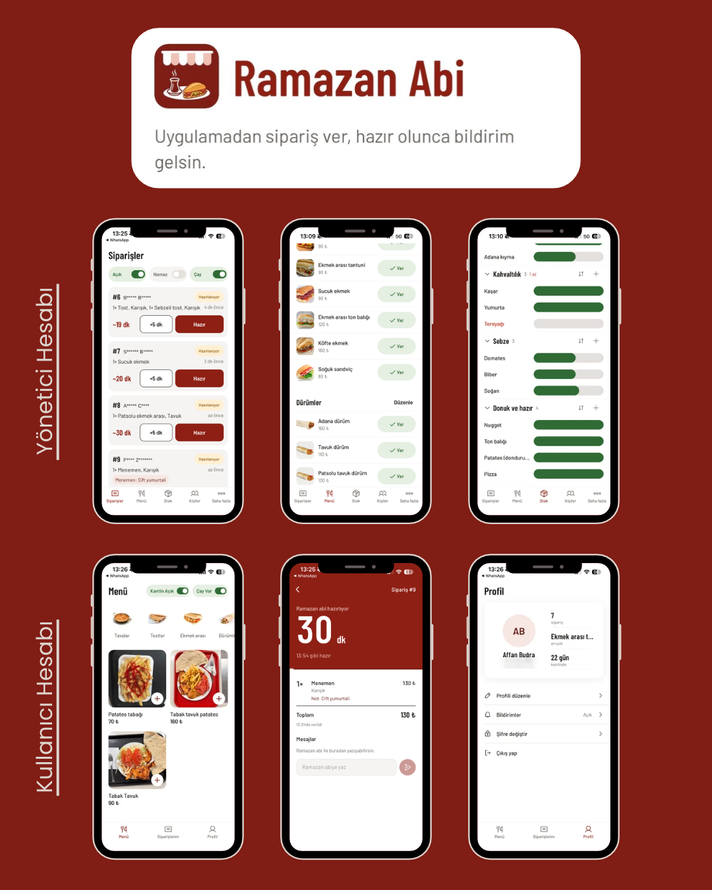

<p align="center">
  
</p>

<h1 align="center">Ramazan Abi</h1>

<p align="center">
  Yurt kantini için sipariş uygulaması. Öğrenci kantine inmeden sipariş verir, sırasını takip eder, hazır olunca bildirim alır.<br>
  Kantinci siparişleri tek ekrandan yönetir.
</p>

<p align="center">
  <a href="https://apps.apple.com/app/ramazan-abi-i-yc-kantin/id6825644917"><b>App Store</b></a> ·
  <a href="https://play.google.com/store/apps/details?id=com.affanbugra.ramazanabi"><b>Google Play</b></a>
</p>

---

<p align="center">
  
</p>

## Ne yapıyor?

**Öğrenci**
- Menüye göz atar (giriş yapmadan da), çeşit seçer, not ekler, sipariş verir.
- Kantinin açık olup olmadığını ve çay durumunu menünün üstünde görür.
- Siparişinin sırasını ve kalan süreyi takip eder; hazırlanınca ve hazır olunca bildirim alır.
- Gerekirse sipariş içinden kantinciyle yazışır.

**Kantinci**
- Gelen siparişleri sırayla görür, süre verir, hazır / teslim edildi olarak işaretler.
- Kantini açar-kapatır, çay durumunu tek dokunuşla değiştirir.
- Menüyü, fiyatları ve stoğu uygulamadan düzenler; günlük raporları görür.
- Öğrencileri tek kullanımlık davet koduyla kaydeder.

## Teknoloji

| Katman | Kullanılan |
|---|---|
| Mobil | Expo (SDK 58), React Native, Expo Router, TypeScript (strict), Zustand |
| Sunucu | Firebase Auth, Firestore, Cloud Functions (europe-west1), Storage |
| Bildirim | Expo Push (APNs / FCM) |
| Dağıtım | EAS Build & Submit, App Store, Google Play |

Fiyat, sipariş numarası, sıra ve yetki gibi kritik değerler istemciye bırakılmaz: sipariş, kayıt ve hesap silme Cloud Functions'ta yapılır, veriye erişim Firestore kurallarıyla sınırlanır. Kurallar ve fonksiyonlar emülatörde otomatik testlerle doğrulanır.

## Klasörler

```
app/          Ekranlar (Expo Router): (auth) giriş ve misafir menüsü, (student), (admin)
src/          Bileşenler, özellikler (menu, cart, orders…), tema, tipler
functions/    Cloud Functions + kural ve fonksiyon testleri
seed/         Başlangıç menüsü ve stok listesi
docs/         README görselleri
```

---

Bir öğrenci yurdunun kantini için geliştirildi; kurumun resmi uygulaması değildir.
